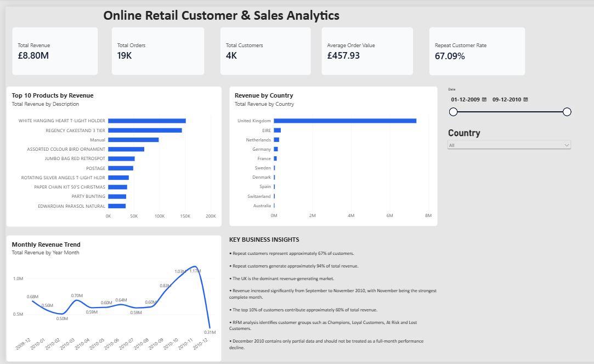
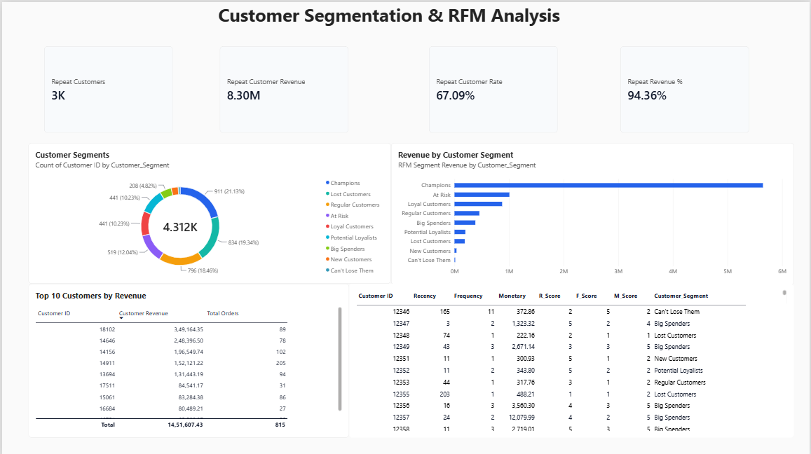
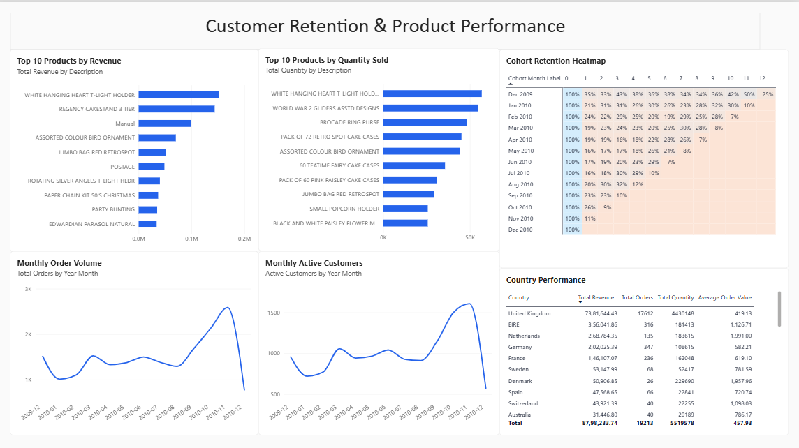

# Online Retail Customer Analytics

## 📊 Project Overview

An end-to-end **Customer & Sales Analytics project** built using the **UCI Online Retail II dataset**.

The project analyses customer purchasing behaviour, sales performance, product performance, customer retention, and revenue contribution using **Python, SQL, and Power BI**.

The goal is to transform raw transactional data into meaningful business insights and actionable recommendations.

---

## 🎯 Business Questions

This project answers key business questions such as:

- Who are the highest-value customers?
- How much revenue comes from repeat customers?
- Which customers may be at risk of becoming inactive?
- Which countries generate the most revenue?
- Which products generate the highest revenue and quantity sold?
- How does revenue change month by month?
- Which customer segments contribute the most revenue?
- How strong is customer retention across cohorts?
- How concentrated is revenue among high-value customers?

---

## 📁 Dataset

**Dataset:** UCI Online Retail II

The dataset contains transactional records from an online retail business.

### Dataset Overview

| Metric | Value |
|---|---:|
| Original Transactions | 525,461 |
| Cleaned Transactions | 400,916 |
| Unique Orders | 19,213 |
| Unique Customers | 4,312 |
| Unique Products | 4,017 |
| Countries | 37 |
| Total Quantity Sold | 5,519,578 |
| Total Revenue | £8,798,233.74 |
| Average Order Value | £457.93 |

---

## 🛠️ Tools & Technologies

- **Python**
- **Pandas**
- **Jupyter Notebook**
- **SQL**
- **DuckDB**
- **Power BI**
- **DAX**
- **RFM Analysis**
- **Cohort Analysis**
- **GitHub**

---

## 🔄 Project Workflow

```text
Raw Transaction Data
        ↓
Data Cleaning — Python
        ↓
Exploratory Data Analysis
        ↓
Customer Analysis
        ↓
RFM Segmentation
        ↓
Cohort Retention Analysis
        ↓
SQL Business Analysis
        ↓
Power BI Dashboard
        ↓
Business Insights & Recommendations
```

---

## 🐍 Python Analysis

Python was used for data cleaning and exploratory analysis.

### Data Cleaning

The following steps were performed:

- Removed duplicate records
- Removed records with missing Customer IDs
- Removed records with missing product descriptions
- Removed transactions with non-positive quantities
- Removed transactions with non-positive prices
- Converted Customer IDs to integer format
- Created a Revenue column

### Exploratory Analysis

The analysis included:

- Monthly revenue trends
- Country-level performance
- Product performance
- Customer revenue analysis
- Top customers
- Revenue concentration
- Repeat customer analysis
- Customer purchasing behaviour

---

## 👥 Customer Analysis

Customer-level metrics were created including:

- Total Orders
- Total Quantity
- Total Revenue
- First Purchase Date
- Last Purchase Date
- Active Months
- Average Order Value

### Revenue Concentration

| Customer Group | Revenue Contribution |
|---|---:|
| Top 1% | 28.58% |
| Top 5% | 48.34% |
| Top 10% | 59.92% |
| Top 20% | 73.53% |

This indicates that a relatively small group of customers contributes a significant share of total revenue.

---

## 🔁 Repeat Customer Analysis

Customer purchase frequency was analysed to understand retention.

- **Total Customers:** 4,312
- **Repeat Customers:** 2,893
- **Repeat Customer Rate:** 67.09%
- **Repeat Customer Revenue:** ~94.36% of total revenue

This highlights the importance of retaining existing customers and increasing customer lifetime value.

---

## 🎯 RFM Customer Segmentation

RFM analysis was performed using:

- **Recency** — How recently a customer purchased
- **Frequency** — How often a customer purchased
- **Monetary** — How much a customer spent

Customers were segmented into groups such as:

- Champions
- Loyal Customers
- Big Spenders
- Potential Loyalists
- New Customers
- At Risk
- Can't Lose Them
- Lost Customers
- Regular Customers

### Key RFM Insight

The **Champions** segment generated approximately **64.93% of total revenue**, making this an important customer group for retention and loyalty strategies.

> Note: RFM segment definitions are project-specific and were created for analytical purposes.

---

## 📈 Cohort Retention Analysis

Cohort analysis was performed based on customers' first purchase month.

The analysis helps identify:

- Customer retention patterns
- Changes in retention across cohorts
- Customer behaviour after the first purchase
- Potential retention opportunities

A **cohort retention heatmap** was created in Power BI to visualise customer retention over time.

---

## 🧮 SQL Analysis

SQL was used to perform business-focused analysis using DuckDB.

The analysis included:

1. Monthly Revenue
2. Top 10 Customers
3. Top 10 Products by Revenue
4. Top 10 Countries by Revenue
5. Repeat vs One-Time Customers
6. Repeat vs One-Time Customer Revenue
7. Customer Ranking using `RANK()`
8. Top 3 Products by Country using `PARTITION BY`
9. Monthly Revenue Growth using `LAG()`
10. Customer Revenue Contribution
11. Customers with More Than 10 Orders
12. Average Order Value by Country

---

## 📊 Power BI Dashboard

The final Power BI dashboard contains **three analytical pages**.

### 1. Executive Overview

Includes:

- Total Revenue
- Total Orders
- Total Customers
- Average Order Value
- Repeat Customer Rate
- Monthly Revenue Trend
- Revenue by Country
- Top 10 Products by Revenue
- Key Business Insights

### 2. Customer Analytics

Includes:

- Repeat Customers
- Repeat Customer Revenue
- Repeat Customer Rate
- Repeat Revenue %
- Customer Segments
- Revenue by Customer Segment
- Top 10 Customers by Revenue
- RFM Customer Analysis

### 3. Customer Retention & Product Performance

Includes:

- Top 10 Products by Revenue
- Top 10 Products by Quantity
- Monthly Order Volume
- Monthly Active Customers
- Country Performance
- Cohort Retention Heatmap

---

## 💡 Key Business Insights

### 1. Strong Repeat Customer Base

Approximately **67.09% of customers are repeat customers**, indicating strong customer purchasing behaviour.

### 2. Repeat Customers Drive Revenue

Repeat customers contribute approximately **94.36% of total revenue**, making retention a major business priority.

### 3. UK Dominates Revenue

The **United Kingdom** is the largest revenue-generating country by a significant margin.

### 4. Revenue is Highly Concentrated

The top 10% of customers contribute approximately **59.92% of total revenue**.

### 5. November Performance

November 2010 recorded the highest revenue among the complete months analysed.

December 2010 was excluded from this comparison because the dataset only contains transactions through **December 9, 2010**.

### 6. High-Value Customers Are Critical

RFM analysis shows that Champions and other high-value customer segments contribute a substantial share of revenue.

---

## 📌 Business Recommendations

Based on the analysis:

- Develop targeted retention campaigns for **At Risk** and **Lost Customers**
- Create loyalty programs for **Champions** and **Loyal Customers**
- Protect relationships with high-value customers
- Analyse the factors behind the strong September–November sales period
- Prioritise the UK market while identifying growth opportunities in other countries
- Use cohort analysis to monitor long-term customer retention
- Develop personalised offers based on customer purchasing behaviour

---

## 📂 Project Structure

```text
online-retail-customer-analytics/
│
├── README.md
│
├── python/
│   └── online_retail_analysis.ipynb
│
├── sql/
│   └── customer_analysis.sql
│
├── power-bi/
│   └── Online_Retail_Customer_Analytics.pbix
│
├── rfm_customer_segments.csv
│
└── dashboard/
    └── dashboard_preview.png
```

---
## 📊 Dashboard Preview

### Executive Overview



### Customer Analytics



### Customer Retention & Product Performance



---

## 🚀 Project Outcome

This project demonstrates an end-to-end data analytics workflow:

**Raw Data → Data Cleaning → Exploratory Analysis → Customer Analytics → RFM → Cohort Analysis → SQL → Power BI → Business Recommendations**

The project demonstrates practical skills in **data cleaning, SQL analysis, customer segmentation, data visualisation, dashboard development, and business-oriented analytics**.
